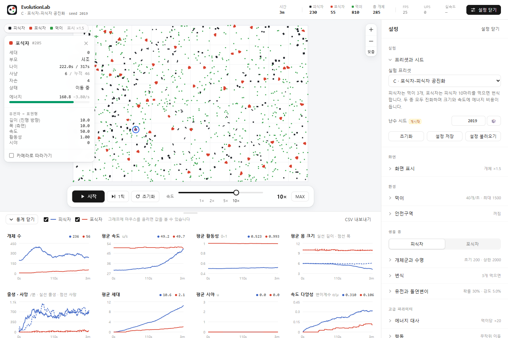

<p align="center">
  
</p>

<h1 align="center">EvolutionLab</h1>

<p align="center">유전과 자연선택을 통해 진화하는 포식자·피식자 생태계를 직접 실험하고 관찰하는 인터랙티브 인공생명 시뮬레이터</p>

<p align="center">
  <a href="https://oyueo-mm.github.io/EvolutionLab/"></a>
</p>
<p align="center">
  <a href="https://github.com/oyueo-mm/EvolutionLab/actions/workflows/deploy.yml"></a>
</p>

> **👉 [https://oyueo-mm.github.io/EvolutionLab/](https://oyueo-mm.github.io/EvolutionLab/)** : 설치 없이 브라우저에서 바로 실행됩니다. ▶ 시작을 누르고 속도를 10×로 올려 보세요.



## 주요 특징

- **코드에 없는 진화**: 형질이 어느 방향으로 변할지 정해 두지 않습니다. 몸의 모양, 이동, 에너지 비용, 번식 조건이 생존과 번식 확률을 바꾸고, 그 결과로 유전자 분포가 변합니다.
- **재현 가능한 실험**: 시드가 같고 설정이 같으면 같은 결과가 나옵니다. 설정은 JSON으로 저장하고 불러오며, 통계는 CSV로 내보냅니다.
- **실시간 관찰**: 개체를 클릭하면 유전자, 에너지, 계보를 볼 수 있습니다. 통계 그래프 8개는 시뮬레이션 데이터에서 직접 계산합니다.
- **실험 도구에 맞춘 화면**: 넓은 캔버스, 접이식 설정과 통계 패널, 0.25×~50× 로그 스케일 속도 조절과 MAX 모드를 갖췄습니다.
- **성능**: 시뮬레이션은 Web Worker에서 고정 시간 간격으로 돌고, 공간 해시와 TypedArray를 씁니다.

## 진화 및 자연선택 시스템

| 요소 | 규칙 |
|---|---|
| **유전자** | 길이(진행 방향), 폭(측면), 속도, 활동성, 시야. 유전자 값이 곧 표현형입니다. |
| **번식** | 주기, 먹은 수, 에너지 기준 중 하나로 정합니다. 무성생식이며 부모 유전자를 복사한 뒤 돌연변이를 적용합니다. |
| **돌연변이** | 유전자마다 확률 p로, 평균 0인 정규분포 N(0, σ²)을 더하고 허용 범위로 자릅니다. 방향성이 없습니다(테스트로 검증). |
| **에너지** | 비용/초 = 기초 + 크기·m + 속도·m·(v/40)²(이동 중) + 활동성·a + 시야·(r/50), m = 길이×폭/36. 각 항은 독립 파라미터입니다. |
| **사냥과 섭식** | 회전 직사각형끼리의 충돌(분리축 정리)로 판정합니다. 그래서 몸이 길쭉한지 납작한지가 실제로 유불리를 만듭니다. |
| **안전구역** | 출입 규칙(피식자만, 포식자만, 모두, 불가)에 따라 금지된 종을 밀어냅니다. 포식자가 들어갈 수 없는 구역 안의 피식자는 잡히지 않습니다. |
| **사망** | 포식, 굶주림(에너지 0), 수명. |

틱 순서, 감지 행동, 경계 처리, 정확한 수식은 [docs/RULES.md](docs/RULES.md)에 있습니다.

## 진화 실험 프리셋

| 프리셋 | 설정 | 헤드리스 반복 실험에서 관찰된 경향 |
|---|---|---|
| **A** 기초 자연선택 | 피식자는 3초마다 분열(상한 500). 진화하지 않는 포식자 25마리가 무작위로 이동 | 피식자 속도 30 → 0.06–2.1 (시드 8/8), 크기 감소. 돌연변이를 끈 대조군은 변화 없음 |
| **A′** 안전구역 | A에 피식자만 들어갈 수 있는 중앙 구역 추가 | 구역 밖으로 덜 나가는 느린 개체가 선택됨 |
| **B** 먹이 기반 번식 | 먹이 5개를 먹으면 분열, 굶으면 사망 | 속도·활동성 증가, 길이 감소, 폭 증가 (시드 6/6) |
| **C** 포식자·피식자 공진화 | 피식자는 먹이 3개, 포식자는 사냥 10회로 번식. 두 종 모두 진화하고 크기와 속도에 에너지 비용 | 시드 6개 모두 공존. 피식자는 빠르고 짧아짐(6/6), 포식자는 폭이 줄고 느려짐(6/6) |
| **V** 시야와 행동 | C에 시야 유전자 추가. 먹이 추적, 포식자 회피, 추격 | — (확장 실험) |

자연선택과 유전적 부동을 구분하는 방법, 모든 매개변수는 [docs/RULES.md](docs/RULES.md)에 정리했습니다. 예를 들어 A에서 피식자 속도가 0에 가까워지면 활동성은 생존과 무관해져서 시드마다 방향이 제각각인데, 이는 선택이 아니라 부동입니다.

## 통계와 시각화

- **그래프 8개**: 개체 수, 평균 속도, 평균 활동성, 평균 몸 크기(길이와 폭), 출생·사망률, 평균 세대, 평균 시야, 속도 다양성(변이계수). 1초 간격 표본을 쓰고, 오래된 데이터는 출생·사망 합계를 보존하며 해상도를 줄입니다.
- **개체 관찰**: 세대, 부모, 나이, 에너지와 초당 소모량, 자손 수, 유전자 값을 보여 주고 카메라가 따라갈 수 있습니다.
- **표시 크기**: 개체는 기본적으로 실제 크기의 1.5배로 그려서 잘 보이게 합니다. 이는 화면 표시일 뿐 충돌, 에너지, 유전자에는 영향이 없습니다. 선택한 개체의 실제 충돌 크기는 파란 윤곽으로 표시되며, 설정 › 화면 표시에서 실제 크기(×1)로 바꿀 수 있습니다.

## 성능

측정 환경은 Intel Core Ultra 7 256V, 헤드리스 Edge입니다. 자세한 표와 측정 방법은 [docs/BENCHMARK.md](docs/BENCHMARK.md)에 있습니다.

- **엔진 단독** (`npm run bench`, 모든 개체가 계속 이동하는 최악 조건)

  | 개체 수 | 틱당 | 실시간 대비 최대 배속 |
  |---:|---:|---:|
  | 1,000 | 0.11ms | 약 300배 |
  | 20,000 | 3.4ms | 약 9.8배 |

- **브라우저**: 20,000마리에서도 시뮬레이션이 도는 동안 메인 스레드 긴 작업 없이 Worker 스냅샷마다(초당 약 30회) 화면을 갱신합니다. Canvas 2D에서 Path를 512개 단위로 나누고, 작은 몸은 축 정렬 사각형으로 단순화하고, 화면 밖 개체는 건너뜁니다.
- **유휴 비용**: 바뀐 것이 없으면 다시 그리지 않으므로, 일시정지 중 메인 스레드 스크립트 사용률은 1% 미만입니다.
- **FPS 표시**: 상단의 FPS는 실제로 다시 그린 프레임 수/초입니다. 실행 중에는 스냅샷 주기(약 30)에 가깝고, 일시정지 중에는 0입니다.

## 기술 스택

React 19 · TypeScript · Vite · Tailwind CSS 4 · HTML Canvas 2D · Web Worker · Recharts · Vitest · Puppeteer(브라우저 회귀 테스트)

WebGL과 WASM은 측정상 아직 필요하지 않아 도입하지 않았습니다([설계 결정 D10](docs/ARCHITECTURE.md)).

## 설치 및 실행

Node.js 20 이상이 필요합니다(개발은 Node 24에서 했습니다).

```bash
npm install
npm run dev        # http://localhost:5173/EvolutionLab/
npm run build      # 타입 검사 + 프로덕션 빌드 → dist/
npm run preview    # 빌드 결과 확인 (http://localhost:4173/EvolutionLab/)
```

**조작**

| 동작 | 방법 |
|---|---|
| 시작 / 정지 | 도크 버튼 또는 `Space` |
| 설정 패널 열기·닫기 | `S` |
| 통계 패널 열기·닫기 | `G` |
| 좁은 화면의 패널 닫기 | `Esc` |
| 확대·축소 / 이동 / 선택 | 휠 / 드래그 / 클릭(탭) |
| 월드 전체 보기 | `맞춤` 버튼 |

패널을 열고 닫으면, 사용자가 직접 시점을 바꾸지 않은 경우 월드가 새 공간에 맞게 자동으로 다시 맞춰집니다. 패널 상태와 표시 크기는 브라우저에 저장됩니다.

## 프로젝트 구조

```
src/sim/            엔진 (순수 TS, DOM 없음): 유전체, 공간 해시, 충돌, 엔진, 프리셋
src/worker/         Web Worker 루프와 메시지 프로토콜
src/client/         Worker 핸들과 통계 이력
src/render/         Canvas 2D 렌더러, 카메라, 표시 크기 계산
src/ui/             React 컴포넌트
e2e/                실제 브라우저 회귀 테스트 (GitHub Pages와 같은 하위 경로로 서빙)
scripts/            bench · tune · replicate (헤드리스), build-icons
public/             로고(logo.svg), 파비콘, 앱 아이콘
docs/               RULES · ARCHITECTURE · BENCHMARK
```

## 테스트 및 벤치마크

```bash
npm test                                 # 단위·통합 테스트 (Vitest)
npm run e2e                              # 빌드된 dist를 실제 브라우저로 검사 (Chrome/Edge 필요, CHROME_PATH로 지정 가능)
npm run e2e -- --url https://oyueo-mm.github.io/EvolutionLab/   # 배포된 사이트 검사
npm run bench                            # 엔진 성능
npx tsx scripts/replicate.ts A 1500 8    # 프리셋 A를 시드 8개로 반복 실험
```

- **단위 테스트**: 유전자 상속과 돌연변이 분포, 에너지 계산, 포식과 사망, 번식 조건, 안전구역, 시드 재현성, 자연선택 발생과 대조군, 공간 해시, 충돌, 통계 변환, 속도 슬라이더, 표시 크기.
- **브라우저 테스트**: 패널을 여닫는 매 프레임마다 캔버스가 검게 칠해지지 않는지 픽셀로 검사하고, 아이콘 로딩, 404와 콘솔 오류, 핵심 조작, 모바일 레이아웃을 확인합니다.

`main`에 push하면 GitHub Actions가 타입 검사, 단위 테스트, 빌드, 브라우저 테스트를 통과한 경우에만 GitHub Pages에 배포합니다.

## 향후 개발 계획

- 시야 감지 비용 줄이기 (현재 엔진의 가장 큰 병목)
- 여러 안전구역과 장애물을 편집하는 UI (엔진은 이미 구역 배열을 지원)
- 계통수 시각화와 유전적 다양성 분석
- 브라우저 안에서 여러 시드를 반복 실험하고 결과를 비교
- 유성생식과 유전자 재조합, 신경망 기반 행동, 날씨와 계절, 질병

## 문서

- [docs/RULES.md](docs/RULES.md): 진화·생태계 규칙, 프리셋 매개변수, 실험 해석 가이드
- [docs/ARCHITECTURE.md](docs/ARCHITECTURE.md): 구조와 설계 결정
- [docs/BENCHMARK.md](docs/BENCHMARK.md): 성능 측정 기록

---

공개된 자연선택 시뮬레이션 실험에서 영감을 받았으며, 시뮬레이션 규칙·엔진·코드·그래픽 자산은 이 저장소에서 독립적으로 작성했습니다. 아직 라이선스를 지정하지 않았습니다(라이선스 파일이 없으면 기본적으로 모든 권리가 저작자에게 있습니다).
